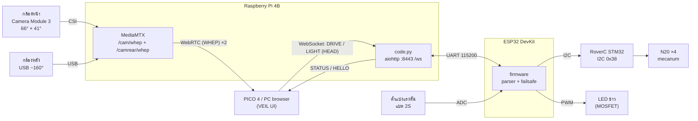

# CN360 — ออกแบบระบบใหม่ (ฐาน RoverC + กล้องหน้า-หลัง)

> สถานะ: **ร่างเพื่อให้ทีมพิจารณา** ยังไม่ได้แก้ `plan.md` ข้อที่ต้องให้ทีมตัดสินใจอยู่ในหัวข้อ 9
> รายการอุปกรณ์: [`hardware.md`](hardware.md)

## 1. สิ่งที่เปลี่ยนจากแผนเดิม

| ส่วน | แผนเดิม (`plan.md`) | แผนใหม่ |
|---|---|---|
| ฐานขับเคลื่อน | แชสซีทำเอง + N20/TT ×2–4 + TB6612FNG | M5Stack RoverC Pro (mecanum ×4, STM32 + L9110S ในตัว) |
| ESP32 → มอเตอร์ | PWM + DIR ไป TB6612FNG | I2C ไป RoverC (`0x38`) |
| การผสมคำสั่งล้อ | differential drive 2 ข้าง | mecanum 4 ล้อ (คำนวณบน ESP32) |
| ไฟมอเตอร์ | แบต 2S ผ่าน driver | แบต 16340 ในตัว RoverC แยกจากแบตหลักโดยธรรมชาติ |
| กล้อง | Pi Camera Module 3 บน pan/tilt SG90 ×2 | **Camera Module 3 (ปกติ) ด้านหน้า + กล้อง USB ~160° ด้านหลัง ติดตายทั้งคู่** |
| หันหัวใน VR | ส่ง `HEAD` → servo หมุนกล้อง | **หมุนมุมมองในแว่นเอง** ไม่ต้องรอหุ่น จุดที่กล้องไม่เห็น → หมุนหุ่นด้วย thumbstick |
| โหมด IR | IR LED + กล้อง NoIR | รอตัดสินใจ (กล้องหน้ารุ่นปกติมองไม่เห็น IR) |

สิ่งที่**ไม่เปลี่ยน**: Protocol v1 (DRIVE / HEAD / LIGHT / STATUS / HELLO), เซิร์ฟเวอร์บน Pi, สาย UART Pi ↔ ESP32, failsafe 2 ชั้น, ค่าคงที่ใน `WORKING_PROCESS.md` §2.3 (เพิ่มแค่ path ภาพกล้องหลัง ดูข้อ 6)

## 2. ภาพรวมระบบ



หน้าที่ของแต่ละบอร์ด:

| บอร์ด | ทำอะไร | ไม่ทำอะไร |
|---|---|---|
| Raspberry Pi 4B | serve UI, รับ WebSocket (operator ทีละคน), ตรวจ/clamp/ตรวจ seq, ส่งต่อไป ESP32, failsafe ชั้น 1, สตรีมภาพ 2 กล้อง, ส่ง STATUS 1 Hz | ไม่คุมฮาร์ดแวร์โดยตรง |
| ESP32 DevKit | parse คำสั่งจาก UART, ผสมล้อ mecanum → I2C, LED PWM, วัดแบต, failsafe ชั้น 2 | ไม่ใช้ Wi-Fi |
| RoverC STM32 | รับความเร็วล้อ 4 ค่าแล้วขับมอเตอร์ | ไม่มี logic ของเรา, ไม่มี timeout (ต้องทดสอบยืนยัน) |

## 3. การไหลของคำสั่ง

```
browser ─ DRIVE,42,0.50,-0.20,1 ─▶ Pi: parse, clamp, ตรวจ seq ─ UART ─▶ ESP32: parse, clamp
                                                                         │
                                         mecanum mix ─ I2C 0x00..0x03 ─▶ RoverC ─▶ ล้อ 4 ล้อ
```

- ESP32 เก็บแค่คำสั่งล่าสุดของแต่ละชนิด ไม่มีคิว
- ESP32 เขียนความเร็วล้อไป RoverC ทุกรอบ loop (50 Hz) ไม่ใช่เฉพาะตอนค่าเปลี่ยน ถ้า RoverC รีเซ็ตกลางทางจะได้ค่ากลับมาเอง
- `HEAD` ยังอยู่ใน protocol แต่ไม่มีอุปกรณ์รับ ESP32 รับไว้ (นับ `ack_seq`) แล้วไม่ทำอะไร จนกว่าทีมจะตัดสินใจ (ข้อ 9)

### การผสมล้อ mecanum

Protocol v1 มีแค่ `linear` (เดินหน้า/ถอย) และ `angular` (หมุน) ไม่มีแกนเดินข้าง สูตรจากไลบรารี M5-RoverC เมื่อ x (เดินข้าง) = 0:

```
y = linear  × max_speed      (−100..100)
z = angular × max_speed

wheel[0] = clamp(y − z)      wheel[1] = clamp(y + z)
wheel[2] = clamp(y − z)      wheel[3] = clamp(y + z)
```

`max_speed` มาจาก `speed_mode` (ดูข้อ 9) ตำแหน่งจริงของ wheel[0..3] และทิศหมุนต้องเช็คบนเครื่องจริงก่อน (ยกล้อลอย)

## 4. Failsafe และความปลอดภัย

| เหตุการณ์ | ใครจับได้ | ผล |
|---|---|---|
| ปิดแท็บ / WebSocket หลุด | Pi | ส่ง `DRIVE,<seq>,0,0,1` ไป ESP32 ทันที |
| ไม่มี `DRIVE` เกิน 300 ms | Pi | เหมือนข้างบน |
| ไม่มีบรรทัดที่ถูกต้องทาง UART เกิน 300 ms (Pi ค้าง, สายหลุด) | ESP32 | เขียน 0 ลง `0x00..0x03` ของ RoverC เอง |
| ESP32 ค้าง / I2C ขาด | **ไม่มีใครจับได้** ถ้า RoverC ไม่มี timeout เอง | สวิตช์ตัดไฟหลัก + task watchdog ของ ESP32 (รีบูตแล้ว boot state = หยุด) |
| เปิดเครื่อง | ESP32 | ล้อ = 0, LED ดับ ก่อนรับคำสั่งแรก |

- ESP32 นับ I2C error ถ้าเขียน RoverC ไม่สำเร็จติดกันหลายครั้ง ให้รายงานผ่าน STATUS (ดูข้อ 6) และลองเขียน 0 ซ้ำ
- **ต้องทดสอบก่อนอย่างอื่น:** สั่ง RoverC ให้ล้อหมุน แล้วหยุดส่ง I2C ดูว่าล้อหยุดเองไหม ผลนี้ตัดสินว่าแถว "ESP32 ค้าง" อันตรายแค่ไหน

## 5. ระบบไฟ

```
แบต 2S 7.4V ─ BMS ─ สวิตช์หลัก ─ ฟิวส์ ─┬─ Buck 5V ≥3A ─▶ Raspberry Pi 4B ─┬─ USB ─▶ กล้องหลัง
                                       │                                  └─ 5V pin ─▶ ESP32
                                       ├─ LED driver ─▶ LED ขาว ─ MOSFET ─ GND
                                       └─ 100k/33k ─▶ ESP32 ADC (8.4V → 2.08V)

แบต 16340 ในตัว RoverC ─▶ มอเตอร์ N20 ×4   (ราง motor แยกจาก Pi ตามกฎ)

GND ร่วม: แบต 2S, Pi, ESP32, RoverC (ขา GND ของ HAT), MOSFET
```

- ไม่ป้อนไฟเข้าขา 5V ของ HAT RoverC จนกว่าจะรู้ว่าขานั้นรับไฟเข้าได้ ต่อแค่ SDA, SCL, GND
- ข้อเสีย: ต้องชาร์จแบต 2 ก้อน และแบต 16340 700 mAh อาจหมดก่อนแบตหลัก ต้องวัดเวลาวิ่งจริง

## 6. Protocol และ path ที่ต้องเพิ่ม

### 6.1 STATUS จาก ESP32 → Pi

ตอนนี้ไม่มีข้อความจาก ESP32 กลับไป Pi แต่ `STATUS` ต้องมี `battery_v` จริง และ ADC อยู่บน ESP32 ข้อเสนอ:

```
STATUS,<seq>,<battery_v>,<ack_seq>      ESP32 → Pi ทาง UART, 1 Hz (รูปแบบเดิม 4 ฟิลด์)
```

- ใช้รูปแบบเดียวกับ STATUS ที่ Pi ส่งให้เบราว์เซอร์ Pi อ่านค่า `battery_v` และ `ack_seq` แล้วส่ง STATUS ของตัวเองต่อ
- ถ้า ESP32 เงียบเกิน 2 วินาที Pi ถือว่า ESP32 หลุด (log + ไม่รายงานแบตที่แต่งขึ้น)

### 6.2 path ภาพกล้องหลัง

| กล้อง | MediaMTX path | WHEP URL (origin เดียวกับหน้าเว็บ) |
|---|---|---|
| หน้า | `cam` (**เดิม ไม่เปลี่ยน**) | `/cam/whep` |
| หลัง | `camrear` (**ใหม่**) | `/camrear/whep` |

กล้องหน้าคง path เดิม UI ปัจจุบันจึงใช้ได้ทันที (เห็นแค่ภาพหน้า) ระหว่างที่ทีม UI ทำส่วนกล้องหลัง

ทั้ง 6.1 และ 6.2 เป็นการเปลี่ยน protocol / ค่าคงที่ร่วม: ต้องเขียนลง `Docs/protocol.md` และ `WORKING_PROCESS.md` §2.3 และแก้ตามรายการใน §2.1 ใน PR เดียว

## 7. ESP32 — ขาและโครงสร้าง firmware

| หน้าที่ | GPIO | หมายเหตุ |
|---|---|---|
| UART2 RX ← Pi TX (GPIO14) | 16 | 115200 baud |
| UART2 TX → Pi RX (GPIO15) | 17 | |
| I2C SDA → RoverC | 21 | |
| I2C SCL → RoverC | 22 | |
| MOSFET LED ขาว | 32 | PWM |
| MOSFET IR LED (ถ้าใช้) | 33 | PWM, สำรองไว้ |
| วัดแบต | 34 | ADC1 (input-only) |

หลีกเลี่ยงขา strapping (0, 2, 5, 12, 15) และขา flash (6–11) เมื่อยืนยันแล้วให้ย้ายตารางนี้ไป `Docs/esp32-pinout.md`

โครงสร้าง firmware (ไม่ขึ้นกับภาษา):

```
main loop 50 Hz
├── line_reader   อ่าน UART แบบ non-blocking, จำกัดความยาวบรรทัด, ล้นแล้วทิ้ง + นับ
├── protocol      parse / ตรวจจำนวนฟิลด์ / clamp / ตรวจ seq  (ไม่มี I/O — เทสได้บน PC)
├── drive         linear, angular, speed_mode → wheel[4] → I2C 0x00..0x03
├── light         brightness, vision_mode → PWM
├── battery       อ่าน ADC เฉลี่ยหลายครั้ง → volt
├── status        ส่ง STATUS ทุก 1 s
└── failsafe      ไม่มีบรรทัดที่ถูกต้อง 300 ms → drive = 0  (ไม่ขึ้นกับ parser)
```

## 8. ลำดับการสร้างและทดสอบ

| ขั้น | ทดสอบอะไร | ผ่านเมื่อ |
|---|---|---|
| H-1 | ESP32 ↔ RoverC ผ่าน I2C (ยกล้อลอย) | หมุนได้ทีละล้อ, รู้ตำแหน่งและทิศของ wheel[0..3] |
| H-2 | RoverC ไม่ได้รับ I2C | รู้ว่าล้อหยุดเองหรือไม่ (บันทึกผลลงเอกสารนี้) |
| H-3 | **ทดสอบน้ำหนัก** วางของ ~300 g บน RoverC | วิ่งตรง เลี้ยว และขึ้นพื้นเอียงเล็กน้อยได้ |
| H-4 | LED + วัดแบตบน ESP32 | LED หรี่ได้, แรงดันตรงกับมัลติมิเตอร์ ±0.1 V |
| H-5 | failsafe ของ ESP32 (ถอดสาย UART) | ล้อหยุดภายใน 300 ms |
| V-1 | MediaMTX 2 stream บน Pi | เปิด `/cam/whep` และ `/camrear/whep` พร้อมกัน 10 นาที ไม่สะดุด, อุณหภูมิ Pi < 75 °C |
| V-2 | ภาพใน PICO | ภาพหน้าโฟกัสนิ่งขณะหุ่นวิ่ง, รับความชัดของภาพหลังได้ |
| I-1..I-8 | ตาม `WORKING_PROCESS.md` §4 | |

ถ้า H-3 ไม่ผ่าน ให้กลับมาตัดสินใจเรื่องฐาน (เปลี่ยนเป็น Pi Zero 2 W หรือกลับไปใช้แชสซีเดิม) **ก่อน**สั่งอุปกรณ์อื่น

## 9. เรื่องที่ทีมต้องตัดสินใจ

1. **ใช้ RoverC แทนแชสซีเดิมหรือไม่** — รอผล H-3
2. **เฟรมเวิร์ก ESP32:** MicroPython (ตรงกับ `code.py` ที่มี) หรือ Arduino/PlatformIO (ต้องใช้ถ้าจะทำ micro-ROS ภายหลัง)
3. **ความหมายของ `speed_mode`** บนฐานที่เปลี่ยนเกียร์ไม่ได้ ข้อเสนอ: `1` = จำกัดความเร็ว 50 % (ขับแม่นในที่แคบ), `2` = 100 % (แรงสุดสำหรับข้ามสิ่งกีดขวาง)
4. **ข้อความ STATUS จาก ESP32 → Pi และ path `/camrear/whep`** (ข้อ 6) — เปลี่ยน protocol / ค่าคงที่ร่วม ต้องอนุมัติทุกคน
5. **`HEAD` จะเก็บไว้หรือตัดออก** — ไม่มี servo แล้ว ข้อเสนอ: เก็บไว้ใน protocol v1 ให้ ESP32 รับแล้วไม่ทำอะไร ส่วน UI หยุดส่งเมื่อใช้โหมดกล้องหน้า-หลัง
6. **โหมด IR (`vision_mode=1`)** — กล้องหน้ารุ่นปกติมองไม่เห็น IR ทางเลือก: ตัดโหมดนี้ หรือเลือกกล้องหลังรุ่น night vision แล้วใช้ IR ส่องด้านหลังเท่านั้น
7. **งานจุดเด่นข้อ 1 ใน `plan.md`** ("หันหัวแล้วกล้องบนหุ่นหันตาม") เปลี่ยนเป็น "หันหัวแล้วมุมมองในแว่นหันตาม" — ต้องแก้ plan และ README
8. **อัปเดต `plan.md` Phase 4–5** ให้ตรงกับเอกสารนี้หลังตกลงแล้ว

## 10. กล้องหน้า-หลัง และการแสดงผลใน VR

### มุมมองที่ได้

```
                    หน้า (Camera Module 3) 66°
                         ╲     ภาพคม      ╱
          มองไม่เห็น ~67°   ╲            ╱   มองไม่เห็น ~67°
         (หมุนหุ่นเอา)       ╲   หุ่น   ╱    (หมุนหุ่นเอา)
                            ╱          ╲
                           ╱  ภาพหยาบ   ╲
                    หลัง (USB) ~160°
```

| | กล้องหน้า | กล้องหลัง |
|---|---|---|
| รุ่น | Pi Camera Module 3 (ปกติ) | กล้อง USB ~160° (MJPEG) |
| มุม (แนวนอน × แนวตั้ง) | 66° × 41° | ~160° × (ขึ้นกับรุ่น) |
| สตรีม | 1920×1080 หรือ 1280×720, H.264 จาก encoder ในตัว Pi | 640×480, Pi แปลง MJPEG → H.264 |
| หน้าที่ | ภาพหลักสำหรับขับและสำรวจ | ดูรอบตัว / ด้านหลัง |

### ตั้งค่า MediaMTX (ร่าง — ตรวจชื่อ option กับเวอร์ชันที่ติดตั้ง)

```yaml
paths:
  cam:                         # กล้องหน้า → /cam/whep
    source: rpiCamera
    rpiCameraWidth: 1280
    rpiCameraHeight: 720
    rpiCameraFPS: 30
    rpiCameraAfMode: manual    # ปิด autofocus ไม่ให้ภาพเบลอเข้าออกตอนวิ่ง
    rpiCameraLensPosition: 0.5 # หน่วย dioptre: 0.5 ≈ โฟกัสที่ 2 m
  camrear:                     # กล้องหลัง → /camrear/whep
    runOnInit: >
      ffmpeg -f v4l2 -input_format mjpeg -video_size 640x480 -framerate 30 -i /dev/video0
      -c:v h264_v4l2m2m -b:v 1M -f rtsp rtsp://localhost:$RTSP_PORT/$MTX_PATH
    runOnInitRestart: yes
```

- กล้อง USB อาจไม่ได้อยู่ที่ `/dev/video0` เสมอ ให้ใช้ `/dev/v4l/by-id/...` แทนเมื่อรู้รุ่นแล้ว
- Pi 4 ใช้ encoder ในตัวกับทั้ง 2 stream (720p + 480p รวมแล้วไม่เกินกำลัง) แต่การแตก MJPEG ใช้ CPU ต้องมีพัดลม

### การแสดงผลใน PICO

- ฉากเป็นทรงกลมรอบตัวผู้ใช้ ภาพหน้าแปะตรงหน้า (กว้าง 66° สูง 41°) ภาพหลังแปะด้านหลัง (กว้าง ~160°)
- ช่องที่ไม่มีภาพแสดงเป็น**พื้นมืดพร้อมป้าย `NO SIGNAL`** ห้ามยืดหรือเติมภาพ (กฎ honesty ของ UI)
- ป้ายแหล่งภาพแยกกัน: `LIVE` เฉพาะกล้องที่ได้ track WebRTC จริง กล้องที่หลุดแสดง `NO SIGNAL`
- **หันหัว = หมุนมุมมองในแว่นเอง** ไม่ต้องรอหุ่น จึงไม่มีอาการภาพตามหลังแบบ servo
- **thumbstick ซ้าย + grip** = ขับ/หมุนหุ่น เพื่อหันกล้องไปยังช่องที่มองไม่เห็น
- ลดอาการเวียนหัวตอนหมุนหุ่น: จำกัดความเร็ว `angular` ในโหมด VR และเพิ่มขอบมืด (vignette) ขณะหุ่นหมุน — UI ชดเชยการหมุนให้ไม่ได้ เพราะไม่มีเซนเซอร์ทิศ (IMU)

### ขั้นตอนเชื่อมต่อ

```
1. PICO 4 ต่อ Wi-Fi  CN360-Robot  (Pi เป็น access point ที่ 192.168.4.1)
2. เปิดเบราว์เซอร์ PICO →  https://192.168.4.1:8443
   └─ ครั้งแรกต้องกดยอมรับใบรับรอง self-signed (WebXR ใช้ได้เฉพาะ HTTPS)
3. หน้าแรกเชื่อม  wss://192.168.4.1:8443/ws  → ได้ HELLO → แสดง Online (hardware) หรือ Simulated (mock)
4. Live view ดึงภาพจาก  /cam/whep  และ  /camrear/whep
5. กด ENTER VR
```

### ปุ่มใน VR

| ใน VR | ข้อความ | บนหุ่น |
|---|---|---|
| หันหัว | — (ไม่ส่ง HEAD) | ไม่มี — หมุนมุมมองในแว่น |
| กดค้าง grip ซ้าย (dead-man) + thumbstick ซ้าย | `DRIVE` 20 Hz | ESP32 → mecanum mix → I2C → RoverC |
| ปล่อย grip / ถอดแว่น / ออกจาก VR / ลิงก์หลุด | หยุดส่ง `DRIVE` (disarm) | Pi failsafe 300 ms → ล้อหยุด |
| ปุ่ม A (ขวา) | `LIGHT` | เปิด/ปิด LED |
| ปุ่ม B (ขวา) | — | recenter มุมมอง |
| ปุ่ม Y (ซ้าย) | — | ออกจาก VR |

### งานฝั่ง UI ที่ต้องทำ (ทีม UI)

- `services/config.ts` + `services/video.ts`: รับ 2 WHEP endpoint, สถานะแยกต่อกล้อง
- `three/immersiveView.ts`: เปลี่ยนจอ 16:9 ที่หมุนตาม HEAD เป็นทรงกลมที่มีภาพหน้า/หลัง + พื้นที่ `NO SIGNAL`, ไม่ส่ง HEAD ในโหมดนี้
- `three/parts.ts` + โมเดล 3D ใน Lobby: เปลี่ยนเป็น RoverC, กล้องหน้า-หลัง, ตัด pan/tilt ออก
- ล้อ mecanum เดินข้างได้ ถ้าเพิ่มแกนเดินข้างใน `DRIVE` ในอนาคต (เปลี่ยน protocol) thumbstick ขวาจะใช้เลื่อนดูด้านข้างได้โดยไม่ต้องหมุนตัว ซึ่งเวียนหัวน้อยกว่า
