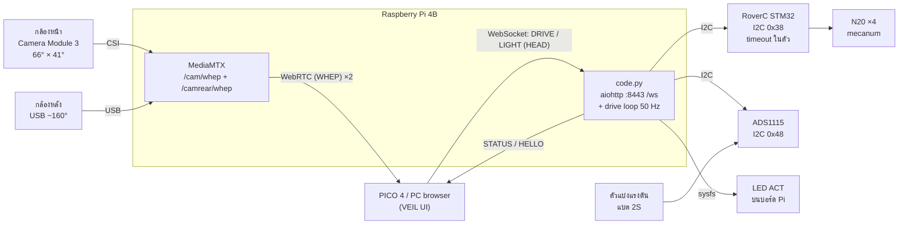

# CN360 — ออกแบบระบบใหม่ (ฐาน RoverC + กล้องหน้า-หลัง, Pi บอร์ดเดียว)

> สถานะ: **ร่างเพื่อให้ทีมพิจารณา** ยังไม่ได้แก้ `plan.md` ข้อที่ต้องให้ทีมตัดสินใจอยู่ในหัวข้อ 9
> รายการอุปกรณ์: [`hardware.md`](hardware.md)

## 1. สิ่งที่เปลี่ยนจากแผนเดิม

| ส่วน | แผนเดิม (`plan.md`) | แผนใหม่ |
|---|---|---|
| ฐานขับเคลื่อน | แชสซีทำเอง + N20/TT ×2–4 + TB6612FNG | M5Stack RoverC Pro (mecanum ×4, STM32 + L9110S ในตัว) |
| สั่งมอเตอร์ | PWM + DIR ไป TB6612FNG | Pi → I2C ไป RoverC (`0x38`) |
| การผสมคำสั่งล้อ | differential drive 2 ข้าง | mecanum 4 ล้อ (คำนวณบน Pi) |
| ไฟมอเตอร์ | แบต 2S ผ่าน driver | แบต 16340 ในตัว RoverC แยกจากแบตหลักโดยธรรมชาติ |
| กล้อง | Pi Camera Module 3 บน pan/tilt SG90 ×2 | **Camera Module 3 (ปกติ) ด้านหน้า + กล้อง USB ~160° ด้านหลัง ติดตายทั้งคู่** |
| หันหัวใน VR | ส่ง `HEAD` → servo หมุนกล้อง | **หมุนมุมมองในแว่นเอง** ไม่ต้องรอหุ่น จุดที่กล้องไม่เห็น → หมุนหุ่นด้วย thumbstick |
| ไฟ | High-Power LED + IR LED ผ่าน MOSFET | **LED ACT บนบอร์ด Pi** — `LIGHT` เหลือแค่ระดับแสง 0–100 (0 = ปิด), ตัดโหมด IR ออก |

สิ่งที่**ไม่เปลี่ยน**: Protocol v1 ระหว่างเบราว์เซอร์กับ Pi (DRIVE / HEAD / STATUS / HELLO — ยกเว้น `LIGHT` ดู [`protocol.md`](protocol.md)), failsafe 2 ชั้นที่ไม่พึ่งกัน, ค่าคงที่ใน `WORKING_PROCESS.md` §2.3 ยกเว้นแถว Serial ที่ไม่ได้ใช้แล้ว และ path ภาพกล้องหลัง (ดูข้อ 6)

## 2. ภาพรวมระบบ



หน้าที่ของแต่ละบอร์ด:

| บอร์ด | ทำอะไร | ไม่ทำอะไร |
|---|---|---|
| Raspberry Pi 4B | serve UI, รับ WebSocket (operator ทีละคน), parse/clamp/ตรวจ seq, ผสมล้อ mecanum → I2C, เปิด/ปิด LED ACT, อ่านแบตจาก ADS1115, failsafe ชั้น 1, สตรีมภาพ 2 กล้อง, ส่ง STATUS 1 Hz | — |
| RoverC STM32 | รับความเร็วล้อ 4 ค่าแล้วขับมอเตอร์, **หยุดล้อเองเมื่อไม่ได้รับ I2C** (failsafe ชั้น 2) | ไม่มี logic ของเรา |

## 3. การไหลของคำสั่ง

```
browser ─ DRIVE,42,0.50,-0.20,1 ─▶ Pi: parse, clamp, ตรวจ seq ─▶ เก็บเป็นคำสั่งล่าสุด
                                                                    │
                          drive loop 50 Hz: mecanum mix ─ I2C 0x00..0x03 ─▶ RoverC ─▶ ล้อ 4 ล้อ
```

- Pi เก็บแค่คำสั่งล่าสุดของแต่ละชนิด ไม่มีคิว
- drive loop เขียนความเร็วล้อไป RoverC ทุกรอบ (50 Hz) ไม่ใช่เฉพาะตอนค่าเปลี่ยน ถ้า RoverC รีเซ็ตกลางทางจะได้ค่ากลับมาเอง และ timeout ของ RoverC จะไม่ทำงานผิดจังหวะขณะขับปกติ
- การเขียน I2C (`smbus2`) เป็น blocking ให้รันใน thread แยก ไม่ใช่ใน event loop ของ aiohttp ถ้า WebSocket ช้าหรือค้าง drive loop ยังเขียน 0 ได้ตามเวลา
- `HEAD` ยังอยู่ใน protocol แต่ไม่มีอุปกรณ์รับ Pi รับไว้ (นับ `ack_seq`) แล้วไม่ทำอะไร จนกว่าทีมจะตัดสินใจ (ข้อ 9)

### การผสมล้อ mecanum

Protocol v1 มีแค่ `linear` (เดินหน้า/ถอย) และ `angular` (หมุน) ไม่มีแกนเดินข้าง สูตรจากไลบรารี M5-RoverC เมื่อ x (เดินข้าง) = 0:

```
y = linear  × max_speed      (−100..100)
z = angular × max_speed

wheel[0] = clamp(y − z)      wheel[1] = clamp(y + z)
wheel[2] = clamp(y − z)      wheel[3] = clamp(y + z)
```

`max_speed` มาจาก `speed_mode` (ดูข้อ 9) ตำแหน่งจริงของ wheel[0..3] และทิศหมุนต้องเช็คบนเครื่องจริงก่อน (ยกล้อลอย)

## 4. Failsafe และความปลอดภัย

| เหตุการณ์ | ใครจับได้ | ผล |
|---|---|---|
| ปิดแท็บ / WebSocket หลุด | Pi | เขียน 0 ลง `0x00..0x03` ของ RoverC ทันที |
| ไม่มี `DRIVE` เกิน 300 ms | Pi | เหมือนข้างบน |
| server ค้าง / process ตาย / Pi รีบูต / สาย I2C หลุด | RoverC | ไม่ได้รับ I2C → หยุดล้อเอง (H-2) |
| Pi ทั้งเครื่องค้าง | RoverC + hardware watchdog ของ Pi | ล้อหยุดจาก timeout ของ RoverC, watchdog รีบูต Pi |
| เปิดเครื่อง / Pi กำลังบูต | RoverC | ยังไม่มี I2C → ล้อหยุด (LED ACT กะพริบตามการอ่าน SD ตามปกติของ Pi จนกว่า server จะเริ่ม) |

- failsafe ชั้น 2 ตอนนี้คือ firmware ของ RoverC ซึ่งเราแก้ไม่ได้ **ต้องวัดเวลาที่ล้อหยุดหลัง I2C เงียบ** แล้วบันทึกลงข้อ 8 (H-2) ถ้าเกินประมาณ 1 วินาที ให้ทีมกลับมาพิจารณาว่ายอมรับได้ไหม
- Pi นับ I2C error ถ้าเขียน RoverC ไม่สำเร็จติดกันหลายครั้ง ให้ log และลองเขียน 0 ซ้ำ
- เปิด hardware watchdog (`dtparam=watchdog=on` + `RuntimeWatchdogSec` ของ systemd) และให้ server รันเป็น systemd service ที่ `Restart=always`
- ต้องมีสวิตช์ตัดไฟหลักเสมอ

## 5. ระบบไฟ

```
แบต 2S 7.4V ─ BMS ─ สวิตช์หลัก ─ ฟิวส์ ─┬─ Buck 5V ≥3A ─▶ Raspberry Pi 4B ─── USB ─▶ กล้องหลัง
                                       └─ 100k/33k ─▶ ADS1115 A0 (8.4V → 2.08V)

แบต 16340 ในตัว RoverC ─▶ มอเตอร์ N20 ×4   (ราง motor แยกจาก Pi ตามกฎ)

GND ร่วม: แบต 2S, Pi, ADS1115, RoverC (ขา GND ของ HAT)
```

- ไม่ป้อนไฟเข้าขา 5V ของ HAT RoverC จนกว่าจะรู้ว่าขานั้นรับไฟเข้าได้ ต่อแค่ SDA, SCL, GND
- ADS1115 เลี้ยงด้วย 3.3 V ของ Pi (ขา 1) แรงดันขา A0 ห้ามเกิน 3.3 V
- ข้อเสีย: ต้องชาร์จแบต 2 ก้อน และแบต 16340 700 mAh อาจหมดก่อนแบตหลัก ต้องวัดเวลาวิ่งจริง

## 6. Protocol และค่าคงที่ที่ต้องเปลี่ยน

### 6.1 STATUS, HELLO และค่าคงที่ I2C

Protocol v1 ฝั่งเบราว์เซอร์เปลี่ยนแค่ `LIGHT` (ดูข้อ 9 ข้อ 6)

- `battery_v` ใน STATUS อ่านจาก ADS1115 โดยตรง ถ้าอ่านไม่ได้ให้ log และไม่รายงานแบตที่แต่งขึ้น
- `HELLO,…,hardware,…` ส่งได้เฉพาะเมื่อ Pi เขียน I2C ไป RoverC ได้จริง
- แถว Serial ใน `WORKING_PROCESS.md` §2.3 ไม่ได้ใช้ ให้แทนด้วยแถว I2C (bus 1, GPIO2/3, RoverC `0x38`, ADS1115 `0x48`)

### 6.2 path ภาพกล้องหลัง

| กล้อง | MediaMTX path | WHEP URL (origin เดียวกับหน้าเว็บ) |
|---|---|---|
| หน้า | `cam` (**เดิม ไม่เปลี่ยน**) | `/cam/whep` |
| หลัง | `camrear` (**ใหม่**) | `/camrear/whep` |

กล้องหน้าคง path เดิม UI ปัจจุบันจึงใช้ได้ทันที (เห็นแค่ภาพหน้า) ระหว่างที่ทีม UI ทำส่วนกล้องหลัง

ทั้ง 6.1 และ 6.2 เปลี่ยนค่าคงที่ร่วม: ต้องแก้ `WORKING_PROCESS.md` §2.3 (และ `Docs/protocol.md` สำหรับ 6.2) ตามรายการใน §2.1 ใน PR เดียว

## 7. Raspberry Pi — ขาและโครงสร้าง server

| หน้าที่ | GPIO (ขา header) | หมายเหตุ |
|---|---|---|
| I2C SDA → RoverC + ADS1115 | 2 (ขา 3) | bus `/dev/i2c-1`, มี pull-up 1.8 kΩ ไป 3.3 V บนบอร์ด |
| I2C SCL → RoverC + ADS1115 | 3 (ขา 5) | เริ่มที่ 100 kHz |
| 3.3 V → ADS1115 VDD | — (ขา 1) | |
| GND | — (ขา 6) | GND ร่วม |

- เปิด I2C ด้วย `raspi-config`
- LED ACT ไม่ใช้ขา header: server ตั้ง `/sys/class/leds/ACT/trigger` เป็น `none` ตอนเริ่ม แล้วเขียน `brightness` เป็น `1`/`0` และคืน trigger เดิม (`mmc0`) ตอนปิด ต้องรันด้วยสิทธิ์เขียน sysfs (root หรือ udev rule) — kernel เก่าบางรุ่นใช้ชื่อ `led0` แทน `ACT`
- ตรวจด้วย `i2cdetect -y 1` ต้องเห็น `38` และ `48`
- เมื่อยืนยันแล้วให้ย้ายตารางนี้ไป `Docs/pi-pinout.md`

โครงสร้าง `Robot/RaspberryPi/`:

```
code.py         aiohttp: static UI, /ws (operator ทีละคน), proxy /cam/whep + /camrear/whep, STATUS 1 Hz
protocol.py     parse / ตรวจจำนวนฟิลด์ / clamp / ตรวจ seq  (ไม่มี I/O — เทสได้บน PC)
drive.py        linear, angular, speed_mode → wheel[4] (pure function) + thread 50 Hz เขียน I2C
                failsafe ชั้น 1: WebSocket ปิด หรือไม่มี DRIVE 300 ms → wheel = 0
light.py        level > 0 → LED ACT ติด, 0 → ดับ (LED ACT หรี่ไม่ได้)
battery.py      อ่าน ADS1115 เฉลี่ยหลายครั้ง → volt
--mock          ไม่แตะ I2C/LED, พิมพ์สถานะจำลอง, HELLO = mock
```

`requirements.txt`: `aiohttp`, `smbus2`

## 8. ลำดับการสร้างและทดสอบ

| ขั้น | ทดสอบอะไร | ผ่านเมื่อ |
|---|---|---|
| H-1 | Pi ↔ RoverC ผ่าน I2C (ยกล้อลอย) | `i2cdetect` เห็น `0x38`, หมุนได้ทีละล้อ, รู้ตำแหน่งและทิศของ wheel[0..3] |
| H-2 | RoverC ไม่ได้รับ I2C | ✅ **ล้อหยุดเอง** (ผลทดสอบ 2026-10-26) — ยังต้องวัดว่าใช้เวลากี่ ms แล้วบันทึกที่นี่ |
| H-3 | **ทดสอบน้ำหนัก** วางของ ~300 g บน RoverC | วิ่งตรง เลี้ยว และขึ้นพื้นเอียงเล็กน้อยได้ |
| H-4 | LED ACT + ADS1115 บน Pi | `LIGHT,…,60` ทำให้ LED ACT ติด, `LIGHT,…,0` ทำให้ดับ และคืนสภาพเดิมเมื่อปิด server, แรงดันตรงกับมัลติมิเตอร์ ±0.1 V |
| H-5 | failsafe ชั้น 2: `kill -9` server ขณะล้อหมุน, และดึงสาย SDA ออก | ล้อหยุดทั้ง 2 กรณี ภายในเวลาที่วัดได้ใน H-2 |
| H-6 | I2C ระหว่างสตรีมภาพ 2 กล้อง 10 นาที | ไม่มี I2C error ต่อเนื่อง, drive loop ไม่พลาดรอบเกิน 300 ms |
| V-1 | MediaMTX 2 stream บน Pi | เปิด `/cam/whep` และ `/camrear/whep` พร้อมกัน 10 นาที ไม่สะดุด, อุณหภูมิ Pi < 75 °C |
| V-2 | ภาพใน PICO | ภาพหน้าโฟกัสนิ่งขณะหุ่นวิ่ง, รับความชัดของภาพหลังได้ |
| I-1..I-8 | ตาม `WORKING_PROCESS.md` §4 (ฝั่งฮาร์ดแวร์คือ Pi + RoverC) | |

ถ้า H-3 ไม่ผ่าน ให้กลับมาตัดสินใจเรื่องฐาน (เปลี่ยนเป็น Pi Zero 2 W หรือกลับไปใช้แชสซีเดิม) **ก่อน**สั่งอุปกรณ์อื่น

ถ้า H-6 ไม่ผ่าน (Pi รับงาน I2C 50 Hz คู่กับวิดีโอไม่ไหว หรือ I2C ของ Pi มีปัญหา clock stretching กับ STM32) ลองลดความเร็วบัสหรือใช้ `i2c-gpio` ก่อน ถ้ายังไม่ได้ ให้ทีมกลับมาทบทวนการออกแบบ

## 9. เรื่องที่ทีมต้องตัดสินใจ

1. **ใช้ RoverC แทนแชสซีเดิมหรือไม่** — รอผล H-3
2. **Pi คุมฮาร์ดแวร์ทั้งหมดบอร์ดเดียว** — failsafe ชั้น 2 คือ timeout ของ RoverC ต้องอนุมัติทุกคน และแบ่งงานใน `WORKING_PROCESS.md` §1 ใหม่ (drive/light/battery บน Pi และวงจร ADS1115)
3. **ความหมายของ `speed_mode`** บนฐานที่เปลี่ยนเกียร์ไม่ได้ ข้อเสนอ: `1` = จำกัดความเร็ว 50 % (ขับแม่นในที่แคบ), `2` = 100 % (แรงสุดสำหรับข้ามสิ่งกีดขวาง)
4. **ค่าคงที่ร่วม: ตัดแถว Serial เพิ่มแถว I2C และ path `/camrear/whep`** (ข้อ 6) — ต้องอนุมัติทุกคน
5. **`HEAD` จะเก็บไว้หรือตัดออก** — ไม่มี servo แล้ว ข้อเสนอ: เก็บไว้ใน protocol v1 ให้ Pi รับแล้วไม่ทำอะไร ส่วน UI หยุดส่งเมื่อใช้โหมดกล้องหน้า-หลัง
6. **`LIGHT` ใหม่: `LIGHT,<seq>,<level 0..100>` (0 = ปิด)** — ตัด `vision_mode` / โหมด IR ออก UI มีปุ่มเปิด/ปิดกับแถบระดับแสง (จำระดับไว้ตอนปิด) เป็นการเปลี่ยน protocol ต้องอนุมัติทุกคน หมายเหตุ: LED ACT หรี่ไม่ได้และส่องทางไม่ได้ ระดับใดๆ ที่มากกว่า 0 = ติด
7. **งานจุดเด่นข้อ 1 ใน `plan.md`** ("หันหัวแล้วกล้องบนหุ่นหันตาม") เปลี่ยนเป็น "หันหัวแล้วมุมมองในแว่นหันตาม" — ต้องแก้ plan และ README
8. **อัปเดต `plan.md` Phase 3–5, `README.md`, `PROJECT_STRUCTURE.md` และ skill `cn360-robot`** ให้ตรงกับเอกสารนี้หลังตกลงแล้ว

## 10. กล้องหน้า-หลัง และการแสดงผลใน VR

### มุมมองที่ได้

```
                    หน้า (Camera Module 3) 66°
                         ╲     ภาพคม      ╱
          มองไม่เห็น ~67°   ╲            ╱   มองไม่เห็น ~67°
         (หมุนหุ่นเอา)       ╲   หุ่น   ╱    (หมุนหุ่นเอา)
                            ╱          ╲
                           ╱  ภาพหยาบ   ╲
                    หลัง (USB) ~160°
```

| | กล้องหน้า | กล้องหลัง |
|---|---|---|
| รุ่น | Pi Camera Module 3 (ปกติ) | กล้อง USB ~160° (MJPEG) |
| มุม (แนวนอน × แนวตั้ง) | 66° × 41° | ~160° × (ขึ้นกับรุ่น) |
| สตรีม | 1920×1080 หรือ 1280×720, H.264 จาก encoder ในตัว Pi | 640×480, Pi แปลง MJPEG → H.264 |
| หน้าที่ | ภาพหลักสำหรับขับและสำรวจ | ดูรอบตัว / ด้านหลัง |

### ตั้งค่า MediaMTX (ร่าง — ตรวจชื่อ option กับเวอร์ชันที่ติดตั้ง)

```yaml
paths:
  cam:                         # กล้องหน้า → /cam/whep
    source: rpiCamera
    rpiCameraWidth: 1280
    rpiCameraHeight: 720
    rpiCameraFPS: 30
    rpiCameraAfMode: manual    # ปิด autofocus ไม่ให้ภาพเบลอเข้าออกตอนวิ่ง
    rpiCameraLensPosition: 0.5 # หน่วย dioptre: 0.5 ≈ โฟกัสที่ 2 m
  camrear:                     # กล้องหลัง → /camrear/whep
    runOnInit: >
      ffmpeg -f v4l2 -input_format mjpeg -video_size 640x480 -framerate 30 -i /dev/video0
      -c:v h264_v4l2m2m -b:v 1M -f rtsp rtsp://localhost:$RTSP_PORT/$MTX_PATH
    runOnInitRestart: yes
```

- กล้อง USB อาจไม่ได้อยู่ที่ `/dev/video0` เสมอ ให้ใช้ `/dev/v4l/by-id/...` แทนเมื่อรู้รุ่นแล้ว
- Pi 4 ใช้ encoder ในตัวกับทั้ง 2 stream (720p + 480p รวมแล้วไม่เกินกำลัง) แต่การแตก MJPEG ใช้ CPU ต้องมีพัดลม

### การแสดงผลใน PICO

- ฉากเป็นทรงกลมรอบตัวผู้ใช้ ภาพหน้าแปะตรงหน้า (กว้าง 66° สูง 41°) ภาพหลังแปะด้านหลัง (กว้าง ~160°)
- ช่องที่ไม่มีภาพแสดงเป็น**พื้นมืดพร้อมป้าย `NO SIGNAL`** ห้ามยืดหรือเติมภาพ (กฎ honesty ของ UI)
- ป้ายแหล่งภาพแยกกัน: `LIVE` เฉพาะกล้องที่ได้ track WebRTC จริง กล้องที่หลุดแสดง `NO SIGNAL`
- **หันหัว = หมุนมุมมองในแว่นเอง** ไม่ต้องรอหุ่น จึงไม่มีอาการภาพตามหลังแบบ servo
- **thumbstick ซ้าย + grip** = ขับ/หมุนหุ่น เพื่อหันกล้องไปยังช่องที่มองไม่เห็น
- ลดอาการเวียนหัวตอนหมุนหุ่น: จำกัดความเร็ว `angular` ในโหมด VR และเพิ่มขอบมืด (vignette) ขณะหุ่นหมุน — UI ชดเชยการหมุนให้ไม่ได้ เพราะไม่มีเซนเซอร์ทิศ (IMU)

### ขั้นตอนเชื่อมต่อ

```
1. PICO 4 ต่อ Wi-Fi  CN360-Robot  (Pi เป็น access point ที่ 192.168.4.1)
2. เปิดเบราว์เซอร์ PICO →  https://192.168.4.1:8443
   └─ ครั้งแรกต้องกดยอมรับใบรับรอง self-signed (WebXR ใช้ได้เฉพาะ HTTPS)
3. หน้าแรกเชื่อม  wss://192.168.4.1:8443/ws  → ได้ HELLO → แสดง Online (hardware) หรือ Simulated (mock)
4. Live view ดึงภาพจาก  /cam/whep  และ  /camrear/whep
5. กด ENTER VR
```

### ปุ่มใน VR

| ใน VR | ข้อความ | บนหุ่น |
|---|---|---|
| หันหัว | — (ไม่ส่ง HEAD) | ไม่มี — หมุนมุมมองในแว่น |
| กดค้าง grip ซ้าย (dead-man) + thumbstick ซ้าย | `DRIVE` 20 Hz | Pi → mecanum mix → I2C → RoverC |
| ปล่อย grip / ถอดแว่น / ออกจาก VR / ลิงก์หลุด | หยุดส่ง `DRIVE` (disarm) | Pi failsafe 300 ms → ล้อหยุด |
| ปุ่ม A (ขวา) | `LIGHT` | เปิด/ปิด LED ACT บนบอร์ด Pi |
| ปุ่ม B (ขวา) | — | recenter มุมมอง |
| ปุ่ม Y (ซ้าย) | — | ออกจาก VR |

### งานฝั่ง UI ที่ต้องทำ (ทีม UI)

- `services/config.ts` + `services/video.ts`: รับ 2 WHEP endpoint, สถานะแยกต่อกล้อง
- `three/immersiveView.ts`: เปลี่ยนจอ 16:9 ที่หมุนตาม HEAD เป็นทรงกลมที่มีภาพหน้า/หลัง + พื้นที่ `NO SIGNAL`, ไม่ส่ง HEAD ในโหมดนี้
- `three/parts.ts` + โมเดล 3D ใน Lobby: เปลี่ยนเป็น RoverC, กล้องหน้า-หลัง, ตัด pan/tilt ออก
- ล้อ mecanum เดินข้างได้ ถ้าเพิ่มแกนเดินข้างใน `DRIVE` ในอนาคต (เปลี่ยน protocol) thumbstick ขวาจะใช้เลื่อนดูด้านข้างได้โดยไม่ต้องหมุนตัว ซึ่งเวียนหัวน้อยกว่า
