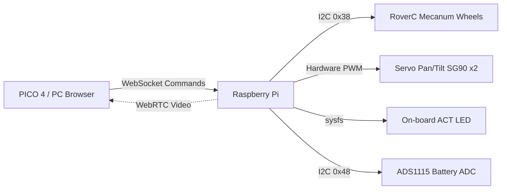

# CN360 Robot Rescue VR

[](https://www.tttracker.space)
[](https://veil-rho-six.vercel.app)
[](https://www.tttracker.space)
[]()
[]()

> หุ่นยนต์กู้ภัยและสำรวจพื้นที่แคบขนาดกะทัดรัด ควบคุมผ่านแว่น PICO 4 VR ด้วยเทคโนโลยี WebXR  
> รองรับการขับเคลื่อนล้อ Mecanum อิสระ, ควบคุมมุมมองกล้อง Pan/Tilt ตามการหันศีรษะ (Head Tracking) และสตรีมมิ่งวิดีโอความหน่วงต่ำผ่าน WebRTC

* **VEIL Operator Web App (ทดลองใช้งาน):** https://veil-rho-six.vercel.app (โหมดจำลอง 360° โดยไม่ต้องต่อฮาร์ดแวร์ หรือเชื่อมต่อหุ่นผ่าน `?robot=<pi-ip>:8443`)
* **ซอร์สโค้ด UI:** [`UI/`](UI/README.md)

---

## ความคืบหน้าล่าสุด (Latest Updates)

สถาปัตยกรรมระบบได้รับการปรับปรุงให้ **Raspberry Pi ควบคุมฮาร์ดแวร์ทั้งหมดโดยตรง** (ไม่ใช้งานบอร์ด ESP32) เพื่อลดความซับซ้อนและลดความหน่วงในการตอบสนอง:

1. **การควบคุมการเคลื่อนที่ผ่าน PICO 4:**
   - พัฒนาระบบบริดจ์ VEIL ⇄ RoverC รองรับ Mecanum Drive (เดินหน้า, ถอยหลัง, เลี้ยว, สไลด์ด้านข้าง) ด้วย Controller บนแว่น PICO 4
   - ทดสอบควบคุมหุ่นจริง M5Stack RoverC สำเร็จอย่างสมบูรณ์ และมีบันทึกวิดีโอสาธิตการใช้งาน
2. **ระบบกล้อง Pan/Tilt และ WebRTC Streaming:**
   - Raspberry Pi ควบคุม Servo SG90 จำนวน 2 ตัวสำหรับกิมบอลกล้อง (Pan/Tilt) ผ่าน Hardware PWM (GPIO 12/13) โดยตรง
   - สตรีมภาพสดจากกล้อง Pi Camera v2 ความหน่วงต่ำผ่าน MediaMTX (WebRTC/WHEP) ขึ้นหน้าเว็บ `vr_rtc.html`
   - รองรับ Head Tracking จาก PICO 4 ผ่าน WebXR (หันศีรษะแล้วกล้องหันตามแบบเรียลไทม์) พร้อมระบบแจ้งเตือนเมื่อสุดระยะหมุนของ Servo
   - ซอร์สโค้ดและวิธีติดตั้งทั้งหมดรวมอยู่ที่ [`Robot/RaspberryPi/pantilt/`](Robot/RaspberryPi/pantilt/)

---

## จุดเด่นของระบบ (Key Features)

| ความสามารถ | รายละเอียด |
|---|---|
| **Immersive VR Control** | ควบคุมผ่าน WebXR Head Tracking และ Controller บนแว่น PICO 4 |
| **Real-time Video** | สตรีมมิ่งวิดีโอสดความหน่วงต่ำจากกล้องบนตัวหุ่นสู่แว่นผ่าน WebRTC |
| **Pan/Tilt Camera** | กิมบอลกล้อง 2 แกน หมุนตามทิศทางการหันศีรษะของผู้ใช้งานจริง |
| **Holonomic Drive** | ขับเคลื่อนล้อ Mecanum 4 ล้อ สามารถเคลื่อนที่ได้ทุกทิศทางอย่างอิสระ |
| **Web-based Architecture** | ใช้งานผ่าน PICO Browser ได้ทันที ไม่ต้องติดตั้งแอปพลิเคชันเพิ่มเติม |

---

## สถาปัตยกรรมระบบ (System Architecture)



**Data Flow:**
* **Control Flow:** PICO 4 / PC Browser ──(WebSocket)──▶ Raspberry Pi ──▶ I2C / PWM / GPIO
* **Video Flow:** Pi Camera v2 ──▶ MediaMTX ──(WebRTC/WHEP)──▶ PICO 4 / Web App

---

## โครงสร้างโปรเจกต์ (Project Structure)

```text
CN360/
├── UI/                  # VEIL Operator Web App (WebXR, Three.js, HUD)
├── Robot/
│   ├── RaspberryPi/     # เซิร์ฟเวอร์หลัก (WebSocket/HTTP), ตัวขับเคลื่อน I2C, แบตเตอรี่, ไฟ LED
│   │   └── pantilt/     # ระบบ Pan/Tilt Servo SG90 x2 และ WebRTC Video Viewer (vr_rtc.html)
│   └── ROS2/            # ROS 2 Integration Bridge (แผนงานในอนาคต)
├── deployment/          # การตั้งค่า Docker Compose, MediaMTX, Caddy, Turn Server
├── TestTools/           # เครื่องมือทดสอบ Protocol และ WebSocket
├── _docs/               # เอกสารสถาปัตยกรรม วงจร ฮาร์ดแวร์ และ Protocol
└── UnityProjects/       # โปรเจกต์ต้นแบบ Unity เดิม (เก็บไว้อ้างอิง)
```

---

## การเริ่มต้นใช้งาน (Getting Started)

### ข้อกำหนดเบื้องต้น
* **Raspberry Pi 4 / 5:** ติดตั้ง Python 3.9+ และเปิดใช้งาน I2C, Hardware PWM
* **PICO 4:** ใช้งานผ่าน PICO Browser (WebXR จำเป็นต้องเข้าใช้งานผ่าน HTTPS หรือ localhost)
* **เครือข่าย:** Raspberry Pi และแว่น PICO 4 เชื่อมต่ออยู่ในเครือข่ายวงเดียวกัน (LAN/Wi-Fi)

### 1. ทดสอบโหมดจำลอง (Mock Mode - ไม่ต่อฮาร์ดแวร์)
```bash
cd UI
npm install
npm run dev
# เปิดเบราว์เซอร์: http://localhost:5173
```

### 2. รันบนฮาร์ดแวร์จริง (Hardware Mode)
```bash
# 1. ตรวจสอบการเชื่อมต่อ I2C (RoverC 0x38, ADS1115 0x48)
i2cdetect -y 1

# 2. เริ่มต้นระบบ Pan/Tilt และ MediaMTX Streaming
cd Robot/RaspberryPi/pantilt
# ดูคู่มือการรัน control.py และ mediamtx ที่ Robot/RaspberryPi/pantilt/README.md

# 3. รัน RoverC Bridge หรือ Server ควบคุม
cd UI
npm run roverc
```

---

## แผนงานพัฒนา (Roadmap)

| Milestone | เป้าหมาย | สถานะ |
|---|---|---|
| **M1** | Command Protocol + WebApp พื้นฐาน | สำเร็จ |
| **M2** | WebRTC Video + WebXR Head Tracking บน PICO 4 | สำเร็จ |
| **M3** | Full Teleop: ขับเคลื่อน RoverC + Pan/Tilt Camera + LED + HUD | กำลังพัฒนา / บูรณาการ |
| **M4** | ROS 2 Bridge + ระบบช่วยนำทางอัตโนมัติ | แผนงานในอนาคต |
| **M5** | การทดสอบภาคสนาม (Field Testing) | แผนงานในอนาคต |

---

## เอกสารอ้างอิงเพิ่มเติม (Documentation)

* [แผนการดำเนินงานแบบละเอียด (plan.md)](plan.md)
* [รายละเอียดโครงสร้างไฟล์ (PROJECT_STRUCTURE.md)](PROJECT_STRUCTURE.md)
* [คู่มือระบบ Pan/Tilt Camera (Robot/RaspberryPi/pantilt/README.md)](Robot/RaspberryPi/pantilt/README.md)
* [สถาปัตยกรรมระบบฮาร์ดแวร์ (_docs/system-design.md)](_docs/system-design.md)
* [ข้อกำหนดคำสั่ง Protocol (_docs/protocol.md)](_docs/protocol.md)
