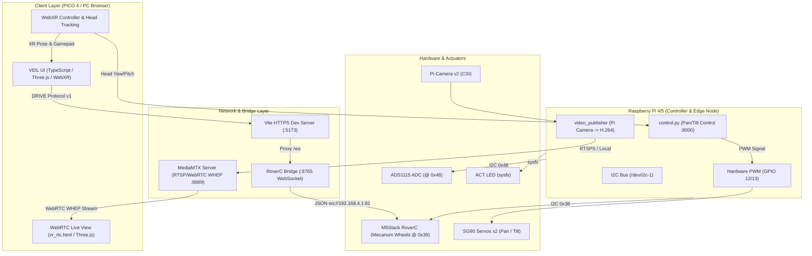

# CN360 — Architecture Map & System Directory

เอกสารนี้รวบรวมแผนผังระบบ (System Architecture) สารบัญไฟล์ทั้งหมดในโปรเจกต์ หน้าที่ของแต่ละโมดูล และการเชื่อมโยงข้อมูลระหว่างกัน

---

## 1. System Architecture (แผนผังสถาปัตยกรรมระบบ)

---

## 2. Directory & File Mapping (สารบัญไฟล์และหน้าที่)

### 2.1 Web App UI Layer (`UI/`)
เว็บแอปพลิเคชันสำหรับควบคุมหุ่นยนต์และแสดงผลในระบบ VR (WebXR)

| ไฟล์ / โฟลเดอร์ | หน้าที่และฟังก์ชันการทำงาน |
|---|---|
| [`UI/src/main.ts`](file:///c:/Users/Natthida/OneDrive/Desktop/CN360/UI/src/main.ts) | จุดเริ่มต้นของแอปพลิเคชัน โหลด Router และเริ่มต้นสถานะระบบ |
| [`UI/src/app/router.ts`](file:///c:/Users/Natthida/OneDrive/Desktop/CN360/UI/src/app/router.ts) | จัดการหน้าจอ: Landing (`#/`), Lobby (`#/lobby`), Immersive (`#/immersive`), Watch (`#/watch`) |
| [`UI/src/app/store.ts`](file:///c:/Users/Natthida/OneDrive/Desktop/CN360/UI/src/app/store.ts) | State management: เก็บสถานะการเชื่อมต่อ, ค่าพิกัดควบคุม, Telemetry |
| [`UI/src/services/locomotion.ts`](file:///c:/Users/Natthida/OneDrive/Desktop/CN360/UI/src/services/locomotion.ts) | แมปปิ้งก้านควบคุม PICO 4 / Gamepad แยกการสไลด์ (Strafe) ซ้าย-ขวา และการหมุน (Rotate) |
| [`UI/src/services/protocol.ts`](file:///c:/Users/Natthida/OneDrive/Desktop/CN360/UI/src/services/protocol.ts) | จัดรูปแบบและตรวจสอบคำสั่ง `DRIVE,seq,linear,angular,boost,strafe`, `HEAD`, `LIGHT` |
| [`UI/src/services/commandLoop.ts`](file:///c:/Users/Natthida/OneDrive/Desktop/CN360/UI/src/services/commandLoop.ts) | ส่งคำสั่งรอบละ 20 Hz สม่ำเสมอ พร้อม Sequence number และ Failsafe |
| [`UI/src/services/transport.ts`](file:///c:/Users/Natthida/OneDrive/Desktop/CN360/UI/src/services/transport.ts) | การเชื่อมต่อ WebSocket Client รองรับการ Reconnect และ Heartbeat |
| [`UI/src/services/video.ts`](file:///c:/Users/Natthida/OneDrive/Desktop/CN360/UI/src/services/video.ts) | Client WebRTC (WHEP) จัดการ PeerConnection และรับสตรีมวิดีโอจาก MediaMTX |
| [`UI/src/three/immersiveView.ts`](file:///c:/Users/Natthida/OneDrive/Desktop/CN360/UI/src/three/immersiveView.ts) | หน้าจอ 3D / WebXR ควบคุมการแสดงผล HUD, มุมมองกล้อง 360°, และปุ่ม VR |
| [`UI/tools/roverc-bridge.mjs`](file:///c:/Users/Natthida/OneDrive/Desktop/CN360/UI/tools/roverc-bridge.mjs) | **บริดจ์แปลงคำสั่ง**: แปลง CN360 Protocol v1 จาก PICO 4 เป็นคำสั่ง JSON ส่งให้ RoverC ผ่าน Wi-Fi AP |
| [`UI/tools/mock-robot.mjs`](file:///c:/Users/Natthida/OneDrive/Desktop/CN360/UI/tools/mock-robot.mjs) | จำลองหุ่นยนต์เสมือนบนเครื่อง สำหรับทดสอบ UI โดยไม่ต้องต่อหุ่นจริง |
| [`UI/vite.config.ts`](file:///c:/Users/Natthida/OneDrive/Desktop/CN360/UI/vite.config.ts) | ตั้งค่า Vite Server, Self-signed HTTPS (`dev:https`), และ WebSocket Proxy |

---

### 2.2 Robot Hardware & Edge Compute Layer (`Robot/RaspberryPi/`)
โค้ดที่รันบนบอร์ด Raspberry Pi ควบคุมฮาร์ดแวร์โดยตรง

| ไฟล์ / โฟลเดอร์ | หน้าที่และฟังก์ชันการทำงาน |
|---|---|
| [`Robot/RaspberryPi/pantilt/control.py`](file:///c:/Users/Natthida/OneDrive/Desktop/CN360/Robot/RaspberryPi/pantilt/control.py) | เซิร์ฟเวอร์ Flask + WebSocket รับค่า Yaw/Pitch แปลงเป็นสัญญาณ Hardware PWM ขับ Servo SG90 |
| [`Robot/RaspberryPi/pantilt/vr_rtc.html`](file:///c:/Users/Natthida/OneDrive/Desktop/CN360/Robot/RaspberryPi/pantilt/vr_rtc.html) | หน้า WebXR Viewer สำหรับ PICO 4: แสดงสตรีม WebRTC พร้อมอ่าน Head Pose ส่งกลับ Pi |
| [`Robot/RaspberryPi/pantilt/mediamtx.yml`](file:///c:/Users/Natthida/OneDrive/Desktop/CN360/Robot/RaspberryPi/pantilt/mediamtx.yml) | คอนฟิก MediaMTX สำหรับรับภาพสดจาก Pi Camera v2 สตรีมแบบ WHEP/WebRTC |
| [`Robot/RaspberryPi/pantilt/systemd/`](file:///c:/Users/Natthida/OneDrive/Desktop/CN360/Robot/RaspberryPi/pantilt/systemd) | Service Files สำหรับเปิดระบบ Pan/Tilt และ MediaMTX อัตโนมัติเมื่อบูตเครื่อง |
| [`Robot/RaspberryPi/video_publisher/`](file:///c:/Users/Natthida/OneDrive/Desktop/CN360/Robot/RaspberryPi/video_publisher) | ตัวอ่านภาพจากกล้อง เข้ารหัส H.264 ด้วย FFmpeg/GStreamer และสตรีมขึ้นเซิร์ฟเวอร์ |
| [`Robot/RaspberryPi/code.py`](file:///c:/Users/Natthida/OneDrive/Desktop/CN360/Robot/RaspberryPi/code.py) | โค้ดหลักบน Raspberry Pi สำหรับจัดการคำสั่ง I2C และ I/O ของตัวหุ่น |

---

### 2.3 Deployment & Infrastructure (`deployment/`)
การตั้งค่าเซิร์ฟเวอร์คลาวด์/เน็ตเวิร์ก สำหรับการสตรีมระยะไกล (Remote Streaming)

| ไฟล์ / โฟลเดอร์ | หน้าที่และฟังก์ชันการทำงาน |
|---|---|
| [`deployment/docker-compose.yml`](file:///c:/Users/Natthida/OneDrive/Desktop/CN360/deployment/docker-compose.yml) | รัน MediaMTX, Coturn (STUN/TURN) และ Caddy Reverse Proxy บน Cloud VPS |
| [`deployment/caddy/Caddyfile`](file:///c:/Users/Natthida/OneDrive/Desktop/CN360/deployment/caddy/Caddyfile) | จัดการ Reverse Proxy และต่ออายุ SSL อัตโนมัติ |
| [`deployment/coturn/turnserver.conf`](file:///c:/Users/Natthida/OneDrive/Desktop/CN360/deployment/coturn/turnserver.conf) | ตั้งค่า NAT Traversal ให้สตรีมมิ่งผ่านเครือข่ายอินเทอร์เน็ตภายนอกได้ |

---

### 2.4 Documentation & Specifications (`_docs/`, root)
เอกสารอ้างอิงและคู่มือการพัฒนา

| ไฟล์ | รายละเอียดเนื้อหา |
|---|---|
| [`README.md`](file:///c:/Users/Natthida/OneDrive/Desktop/CN360/README.md) | เอกสารภาพรวมโปรเจกต์ จุดเด่น วิธีการรัน และความคืบหน้าล่าสุด |
| [`plan.md`](file:///c:/Users/Natthida/OneDrive/Desktop/CN360/plan.md) | แผนการทำงานและสถานะแต่ละ Milestone (M1 ถึง M5) |
| [`PROJECT_STRUCTURE.md`](file:///c:/Users/Natthida/OneDrive/Desktop/CN360/PROJECT_STRUCTURE.md) | กฎเกณฑ์และโครงสร้างโฟลเดอร์ของทั้งโปรเจกต์ |
| [`_docs/protocol.md`](file:///c:/Users/Natthida/OneDrive/Desktop/CN360/_docs/protocol.md) | สเปกข้อความคำสั่ง Protocol v1 (`DRIVE`, `HEAD`, `LIGHT`, `STATUS`) |
| [`_docs/system-design.md`](file:///c:/Users/Natthida/OneDrive/Desktop/CN360/_docs/system-design.md) | การออกแบบเชิงสถาปัตยกรรม (ย้ายมาใช้ Raspberry Pi เดี่ยว) |
| [`_docs/pi-pinout.md`](file:///c:/Users/Natthida/OneDrive/Desktop/CN360/_docs/pi-pinout.md) | แผนผังขา GPIO, I2C Bus, Hardware PWM, และการจ่ายไฟ |
| [`_docs/hardware.md`](file:///c:/Users/Natthida/OneDrive/Desktop/CN360/_docs/hardware.md) | รายการอุปกรณ์ (BOM) และสเปกทางวิศวกรรม |
